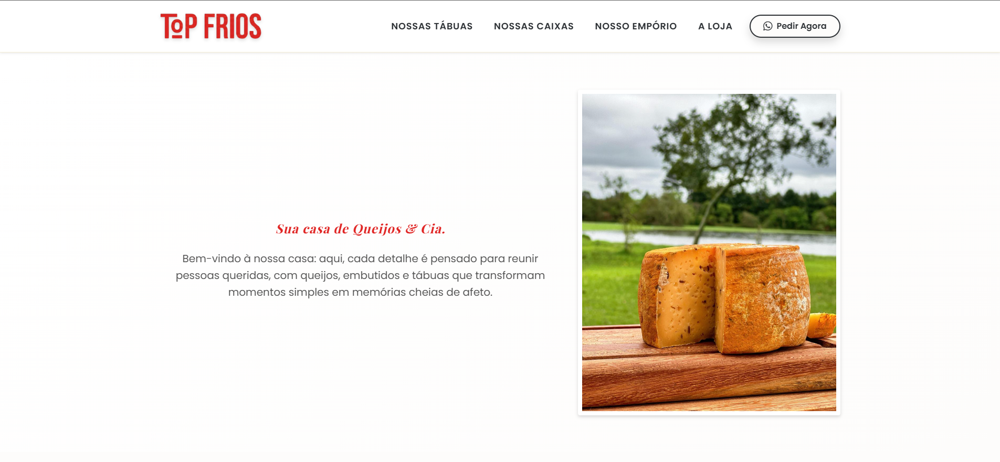

# Top Frios - Queijos, Tábuas de Frios e Iguarias

Este é o site oficial da **Top Frios**, uma casa especializada em queijos premium, tábuas de frios artesanais e produtos de empório, localizada em São José dos Pinhais - PR.

O projeto foi desenvolvido para oferecer uma experiência de catálogo digital fluida, permitindo que os clientes visualizem as opções de tábuas, caixas de presentes e produtos do empório antes de realizar o pedido via WhatsApp.

🔗 **Link do Projeto:** [https://topfriosqueijosecia.com.br/](https://topfriosqueijosecia.com.br/)

## 🚀 Tecnologias Utilizadas

O projeto foi construído utilizando tecnologias modernas de front-end para garantir performance e responsividade:

* **HTML5** - Estrutura semântica.
* **CSS3 / Bootstrap 5** - Estilização e layout responsivo (Mobile First).
* **JavaScript** - Interatividade e funcionalidades dinâmicas.
* **Google Fonts** - Tipografia personalizada para uma identidade visual sofisticada.
* **Font Awesome** - Iconografia.

## ✨ Funcionalidades

- **Catálogo Interativo:** Exibição detalhada de tábuas de frios e boxes com preços e composições.
- **Menu de Empório:** Seção dedicada a queijos especiais, embutidos, antepastos e vinhos.
- **Depoimentos de Clientes:** Seção de avaliações integrando prova social.
- **Responsividade Total:** Site totalmente otimizado para dispositivos móveis, tablets e desktops.
- **Botão de Pedido Direto:** Integração com WhatsApp para facilitar a conversão de vendas.
- **Mapa de Localização:** Informações claras sobre a loja física e horários de atendimento.

## ✒️ Desenvolvedor

Este projeto foi idealizado e desenvolvido por:

* **[Thiago Anacleto](https://www.linkedin.com/in/thiagoviniciosanacleto/)** * **GitHub:** [@ThiagoViniciosAnacleto](https://github.com/ThiagoViniciosAnacleto)

## 📄 Licença e Direitos Autorais

Este software e todos os arquivos associados são de propriedade exclusiva de **Thiago Anacleto**. Todos os direitos autorais sobre o código-fonte, layout e design são reservados.

Fica estritamente proibido:
1. Copiar, modificar ou distribuir o código-fonte ou partes dele.
2. Usar este software para fins comerciais ou privados sem a autorização expressa do autor.

---
© 2026 Thiago Anacleto. Todos os direitos reservados.